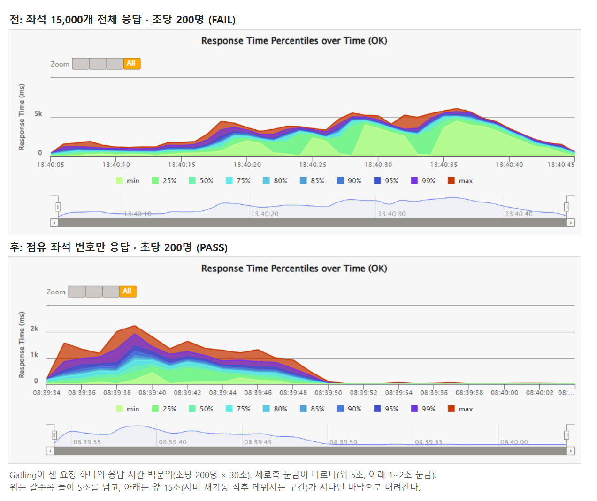
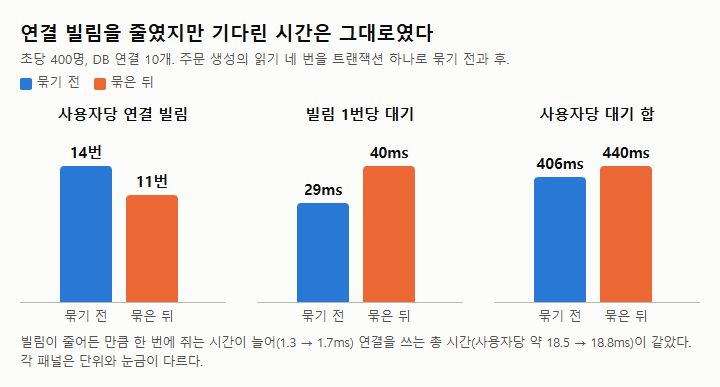
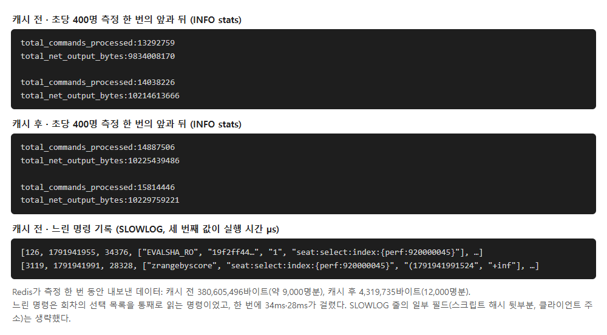
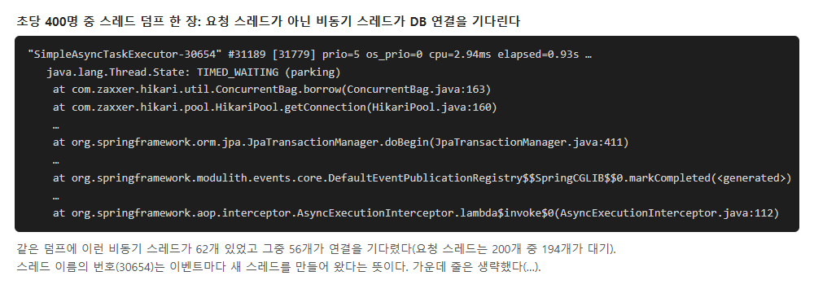

# 응답을 줄이자 한계가 두 배가 됐고, 다음 벽은 숨어 있던 스레드였다: 티켓 예매 부하 테스트 2편

- 초당 200명에서 무너지던 예매 흐름을, 좌석 15,000개 상태 대신 **점유된 좌석 번호만** 보내게 바꿔 초당 300명까지 통과시켰다.
- DB 연결을 빌리는 횟수를 14번에서 11번으로 줄였지만 기다린 시간은 그대로였다. 대기를 정하는 것은 횟수가 아니라 **연결을 쓰는 총 시간**이었다.
- 요청마다 Redis에서 목록 전체를 읽던 것을 1초 캐시로 바꿔, 초당 400명 측정 한 번의 Redis 송신을 380MB에서 4MB로 줄였다. 그 뒤에서 **상한 없이 생기는 비동기 스레드**가 DB 연결을 나눠 쓰는 것을 찾았다.

## 무엇을 쟀나

지난 글에 이어 같은 공연 예매 백엔드(Spring Boot, PostgreSQL, Redis)다. 데이터는 회원 100만 명, 과거 주문 500만 건, 15,000석짜리 회차다.
대기열이 초당 N명을 들여보낸다고 보고 N명/초를 30초 동안 넣었다. 한 명은 공연 요약 → 좌석 조회 → 좌석 선택 → 주문 생성 → 주문 확인을 한다.

다섯 요청을 끝내는 시간의 p99가 5초를 넘으면 실패로 봤다. 부하 발생기, 서버, DB, Redis가 PC 한 대(16코어)를 나눠 쓰므로 숫자는 병목을 찾는 용도다.

## 1. 초당 200명: 연결 대기처럼 보였지만 CPU가 차 있었다

초당 150명은 통과했고 200명에서 p99가 17.9초까지 늘었다. 스레드 덤프를 떠 보니 요청 스레드 200개 중 186개가 DB 연결을 기다리고 있었다. 처음에는 연결 풀이 작다고 봤다.

그런데 PC 전체 CPU가 100%였다. 사용자가 좌석 화면에 들어올 때마다 서버는 좌석 15,000개 상태를 읽어 약 1MB짜리 JSON으로 만들고 압축했다. 서버는 사용자 한 명에 메모리를 **7.7MB**씩 새로 할당했고, 대부분 이 변환 비용으로 본다. CPU가 차자 연결을 쥔 스레드도 늦게 돌아, 초당 100명일 때 1.3ms이던 연결 한 번 쓰는 시간이 5.4ms로 늘었다.

좌석 위치와 등급은 화면이 이미 따로 받는 배치도에 있다. 그래서 상태 API는 "빈 좌석이 아닌 좌석 번호"만 보내게 바꿨다. 목록에 없는 좌석은 빈 좌석이다.

```json
// 전: 좌석 15,000개를 전부 보낸다
{"seats":[{"performanceSeatId":1001,"seatId":12345,"status":"AVAILABLE"}, ...]}
// 후: 막힌 좌석 번호만 보낸다
{"occupiedSeatIds":[12345, 12399, ...]}
```

| 초당 200명 | 전 | 후 |
| --- | --- | --- |
| 판정 | FAIL (p99 17.9초) | **PASS** (p99 3.9초) |
| 사용자당 메모리 할당 | 7.7MB | 2.5MB |
| 통과한 최대 부하 | 초당 150명 | 초당 300명 |



배운 점: 연결 대기는 결과일 수 있다. 연결을 쥔 쪽이 왜 느린지부터 본다.

## 2. 연결 빌림을 줄였는데 연결 대기는 그대로였다

초당 400명에서 다시 연결 대기가 보였다. 사용자 한 명이 연결을 14번 빌렸고, 붐빌 때 한 번 빌리는 데 평균 29ms를 기다렸다. 주문 생성 하나만 연결을 5번 빌렸다. 판매 정책, 회원, 진행 중 주문과 좌석, 표시값을 외부 호출 없이 연달아 읽는데도 저마다 따로 빌렸기 때문이다.

연달아 읽는 부분을 읽기 전용 트랜잭션 하나로 묶어, 주문 생성의 빌림을 2번(읽기 1번, 저장 1번)으로 줄였다. 안쪽 메서드의 `@Transactional`은 기본 전파 방식(REQUIRED)이라 바깥 트랜잭션에 참여해 같은 연결을 쓴다. Redis 선점과 주문 저장은 지금처럼 그 밖에 둔다.

```java
@Transactional(readOnly = true)          // 연결은 여기서 한 번만 빌린다
public Preflight read(...) {
    var policy = entryGuard.check(...);  // 판매 기간·입장권
    memberLookup.requireActive(memberId);
    ensureNoPendingOrder(...);
    return new Preflight(policy, requireAvailableSeats(...), saleInfo.snapshot(...));
}
```

| 초당 400명 | 묶기 전 | 묶은 뒤 |
| --- | --- | --- |
| 사용자당 연결 빌림 | 14번 | 11번 |
| 연결 한 번 쥐는 시간 | 1.3ms | 1.7ms |
| 빌림 1번당 대기 | 29ms | **40ms** |
| 사용자당 대기 합 | 약 406ms | 약 440ms |

빌림이 줄어든 만큼 한 번에 오래 쥐어서, 연결을 쓰는 총 시간(사용자당 18~19ms)이 그대로였다. 계산대가 같은 비율로 바쁘면 한 번 줄 서는 시간은 앞사람이 계산대를 쓰는 시간만큼 길어진다. 평균 체류는 7.1초에서 4.8초로 줄었지만 400명은 여전히 실패였고, 줄어든 몫은 주문 생성 자체가 빨라진 덕으로 본다.



배운 점: 대기를 정하는 것은 빌림 횟수가 아니라 사용률(연결을 쓰는 총 시간 ÷ 연결 수)이다. 묶기는 총 시간이 줄 때만 효과가 있다.

## 3. Redis 일꾼 한 명이 목록을 뽑느라 바빴다

초당 400명에서 Redis CPU가 최대 1.00코어였다. Redis는 명령을 스레드 하나로 처리해서 1코어가 상한이다. 덤프 한 장에서 요청 스레드 177개가 Redis 응답을 기다렸고, 사용자 체류 시간(중앙값)은 30초 동안 2.0초에서 7.5초로 계속 늘었다.

점유 좌석 조회가 요청마다 Redis의 "선택 중인 좌석 목록"과 "선점된 좌석 목록"을 **통째로** 읽고 있었다. 측정 한 번(약 9,000명분)에 Redis가 **380MB**를 내보냈고, 대부분 이 응답으로 보인다. 조회 9,494번이었으니 한 번에 약 40KB다. 점유가 쌓일수록 한 번에 읽는 양이 커지고, 큰 명령이 도는 동안 좌석 락 같은 짧은 명령도 줄을 섰다. 이 읽기는 원래부터 있었는데, 앞의 병목을 걷어 처리량이 늘자 드러났다.

점유 목록은 화면 표시용이다. 바뀐 좌석은 WebSocket이 따로 알리고, 좌석을 실제로 잡을 때는 좌석 하나짜리 키를 락 안에서 확인한다. 그래서 목록을 회차별로 1초 동안 서버 메모리에 두고 재사용했다. 같은 회차를 동시에 놓친 요청은 먼저 읽은 결과를 기다렸다 쓴다.

```java
// 회차마다 1초에 한 번만 Redis를 읽는다
Snapshot s = snapshots.compute(performanceId, (id, cur) ->
        cur != null && cur.isFresh(clock.millis()) ? cur : load(id));
```

| 초당 400명 | 캐시 전 | 캐시 후 |
| --- | --- | --- |
| Redis가 내보낸 데이터 | 380MB(약 9,000명분) | **4MB**(12,000명분) |
| Redis CPU 최대 | 1.00코어 | 0.73코어 |
| 덤프 속 Redis 대기 스레드 | 177개 | 7개 이하 |
| 판정 | FAIL | FAIL |



배운 점: 모두가 같은 큰 값을 읽으면 공유 캐시(Redis) 앞에 로컬 캐시를 한 겹 둔다. 표시용만 캐시하고, 판정에는 원본을 쓴다.

## 4. 그래도 400명이 안 되는 이유: 숨어 있던 스레드

Redis가 풀리자 DB 연결 풀이 다시 맨 앞에 섰다(평균 사용률 94~98%). 연결 한 번 쥐는 시간이 1.7ms에서 2.4ms로 늘었는데, 이유는 아직 확인하지 못했다. 연결이 새는지부터 확인했는데 누수는 없었다. 대신 덤프에 요청 스레드가 아닌 비동기 스레드가 62개 있었고, 그중 56개가 연결을 기다렸다.

주문이 생기면 뒤에서 후처리(선택 정리, "선점됨" 알림)와 이벤트 처리 완료 기록(Spring Modulith)이 돈다. 이 일이 사용자당 연결 빌림 10번 중 약 2번을 차지했다. 게다가 이벤트마다 새 스레드를 만드는 `SimpleAsyncTaskExecutor`가 쓰여, 동시에 도는 후처리에 상한이 없었다.



선점이 몰린 지 10분 뒤 한꺼번에 만료될 때도 같은 후처리가 몰린다. 그래서 이것은 처리량보다 안정성 문제다.

## 정리

| 단계 | 결과 |
| --- | --- |
| 지난 글 끝 | 초당 100명 통과 |
| 점유 좌석 번호만 응답 | 초당 300명 통과, 400명 실패 |
| 연결 빌림 묶기, Redis 1초 캐시 | 400명 실패(병목이 DB 연결 풀로 이동) |

배운 점 세 가지:

1. 병목은 하나를 걷어야 다음이 보인다. 이번에는 CPU → DB 연결 → Redis → 숨은 스레드 순서였다.
2. 대기의 크기는 사용률이 정한다. 빌림 횟수를 줄여도 총 사용 시간이 같으면 대기는 그대로다.
3. 표시용 데이터는 짧게 캐시해도 되고, 판정용 데이터는 원본을 본다.

다음에는 비동기 후처리 실행기에 상한(스레드 몇 개와 대기열)을 두고 다시 잰다. 그다음 부하 발생기를 분리해, 좌석 경합과 생각 시간이 있는 실제 사용자 흐름으로 15분 동안 잰다.
