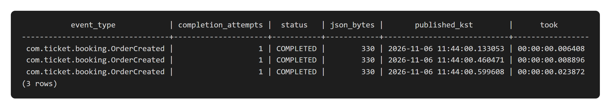
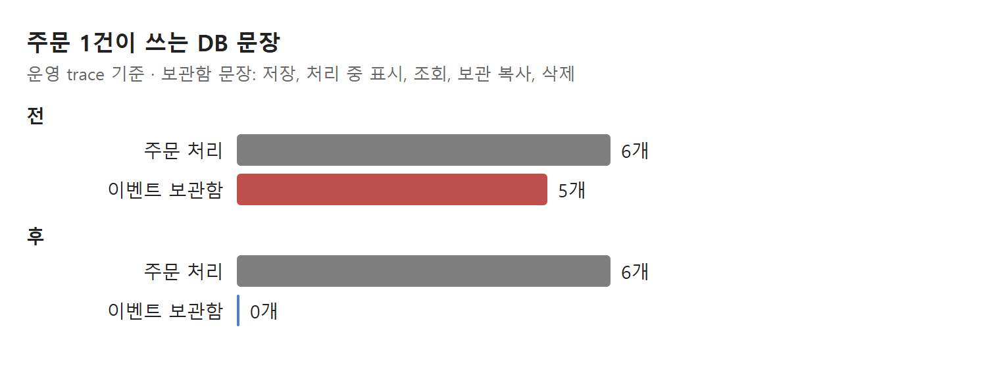
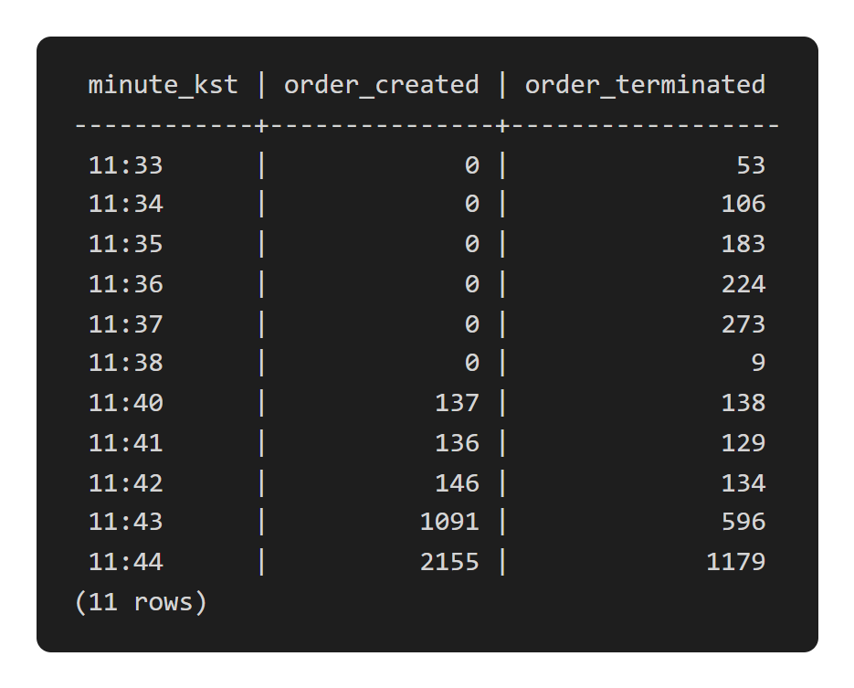

# 주문마다 DB 문장 5개를 쓰던 이벤트 보관함을 뺐다: 되살려도 쓸모없는 후처리

- 주문을 만들면 후처리 이벤트를 DB 보관함에 넣고, 커밋 뒤 다른 스레드가 꺼내 처리했다. 주문 한 건에 보관함 문장이 **5개**였다.
- 보관함이 실패한 후처리를 되살리는 시점은 5~6분 뒤인데, 그때는 후처리할 대상이 이미 사라져 있었다.
- 보관함을 빼고 커밋 직후 바로 부르게 바꿨다. 주문 한 건의 DB 문장은 11개에서 6개가 됐다.

## 무엇을 바꿨나

공연 예매 백엔드(Spring Boot, PostgreSQL, Redis)에서 주문을 만드는 경로다. 주문을 저장한 뒤 할 일이 하나 있다. 이 사용자의 좌석 "선택 중" 표시를 지우고, 같은 회차를 보는 사람들에게 "이 좌석은 주문 중"이라고 알리는 일이다.

이 후처리는 Spring Modulith의 이벤트 보관함(event publication registry)으로 했다. 보관함은 이벤트를 주문과 같은 트랜잭션으로 DB에 저장하고, 커밋 뒤 리스너를 부른다. 서버가 그 사이 죽어도 저장된 이벤트를 나중에 다시 처리한다(최소 한 번 전달).

## 1. 보관함은 공짜가 아니었다

운영 trace로 주문 한 건이 쓰는 DB 문장을 셌더니 11개였고, 그중 5개가 보관함이었다. 이벤트 저장, 처리 중 표시, 조회, 보관용 표로 복사, 원래 행 삭제다. 끝난 이벤트를 남겨 두는 설정(archive) 때문에 복사와 삭제가 붙었다.

로컬 DB의 보관용 표에서 실제로 쌓인 행을 봤다. 주문마다 330바이트짜리 JSON이 한 줄씩 남았고, 저장부터 처리 끝까지 6~24ms 걸렸다.





## 2. 되살려 봐야 할 일이 없었다

보관함의 값은 "실패해도 나중에 다시 한다"는 데 있다. 그래서 다시 할 때 그 일이 여전히 의미 있는지를 따져 봤다.

- 보관함은 끝나지 않은 이벤트를 5분이 지나야 오래된 것으로 보고, 1분마다 다시 처리한다. 되살아나는 시점은 5~6분 뒤다.
- 지울 대상인 좌석 선택 기록은 Redis 키라 5분 뒤 스스로 사라진다. 되살아났을 때는 이미 없다.
- 다른 사람 화면은 "선택 중"과 "주문 중"을 똑같이 막힌 좌석으로 그린다. 알림이 빠져도 화면 모양은 같다.
- 좌석이 두 번 팔리지 않게 막는 것은 Redis의 선점 키다. 이 후처리와 상관없다.

결국 주문마다 문장 5개를 들여 지키던 것은 5~6분 뒤에 아무것도 안 하는 재시도였다.

배운 점: "최소 한 번 전달"은 다시 할 때 의미가 남아 있는 일에만 값어치가 있다.

## 3. 커밋 직후 바로 부른다

주문 트랜잭션이 커밋되면 같은 요청 안에서 후처리를 바로 부른다. 실패하면 로그만 남기고 주문은 성공으로 응답한다.

```java
orderKey = pendingOrderCreator.create(...);   // 주문 저장, 여기서 커밋(이벤트 발행 없음)
// 커밋 뒤 후처리: 선택을 지우고 "주문 중"을 알린다
try {
    heldSeatPublisher.clearSelectionsAndPublishHeld(hold.holdKey(), memberId, snapshot);
} catch (RuntimeException e) {
    log.warn("주문 생성 후처리에 실패했습니다. holdKey={}", hold.holdKey(), e);   // 주문은 성공
}
```

같은 날 로컬 측정에서 바꾼 서버와 원래 서버를 차례로 돌렸다. 보관용 표를 분 단위로 세면 바꾼 서버가 돈 시간(11:33~11:38)에는 주문 생성 이벤트가 0건이다.



| 주문 생성 1건 | 전 | 후 |
| --- | --- | --- |
| DB 문장 | 11개 | **6개** |
| 후처리 실패 시 | 5~6분 뒤 재처리 | 로그만 남김 |
| 주문 결과 | 성공 | 성공 |

이 변경만으로 주문 응답 시간이 얼마나 줄었는지는 따로 재지 않았다. 같은 묶음의 다른 변경과 함께 쟀을 때 초당 40명에서 주문 요청이 8.0ms에서 6.7ms가 됐다.

## 4. 보관함을 남긴 쪽

주문이 취소되거나 만료된 뒤 좌석 선점을 푸는 일은 그대로 보관함을 쓴다. 이 일은 좌석을 다시 팔 수 있게 만드는 일이라 몇 분 늦게라도 하면 의미가 있다. 주문 생성 후처리와 달리, 다시 할 때 할 일이 남아 있다.

| 후처리 | 늦게 해도 의미가 있나 | 보관함 |
| --- | --- | --- |
| 주문 생성 뒤 선택 정리·알림 | 없다(5분 뒤 스스로 사라짐) | 뺐다 |
| 취소·만료 뒤 선점 해제 | 있다(좌석을 다시 판다) | 남겼다 |

## 정리

- 이벤트 보관함은 이벤트마다 DB 쓰기 여러 번이 붙는다. 처리량이 중요한 경로라면 그 비용을 세어 본다.
- 재시도가 실제로 일어나는 시점에 그 일이 아직 의미 있는지 확인한다. 아니라면 보관함이 지키는 것은 없다.
- 정확성이 다른 곳(여기서는 Redis 선점 키)에서 지켜지면, 후처리는 한 번 시도하고 실패를 기록하는 것으로 충분할 수 있다.

다음은 운영에 배포하기 전에 아직 처리되지 않은 옛 이벤트가 남아 있는지 확인하는 일이다.
