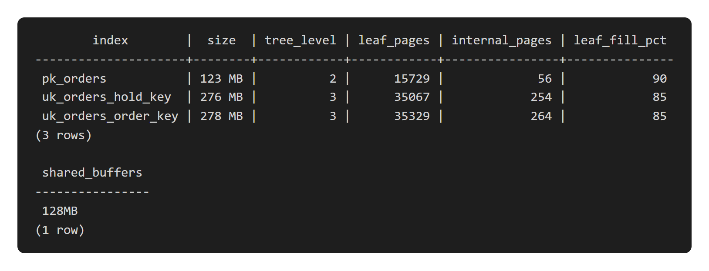
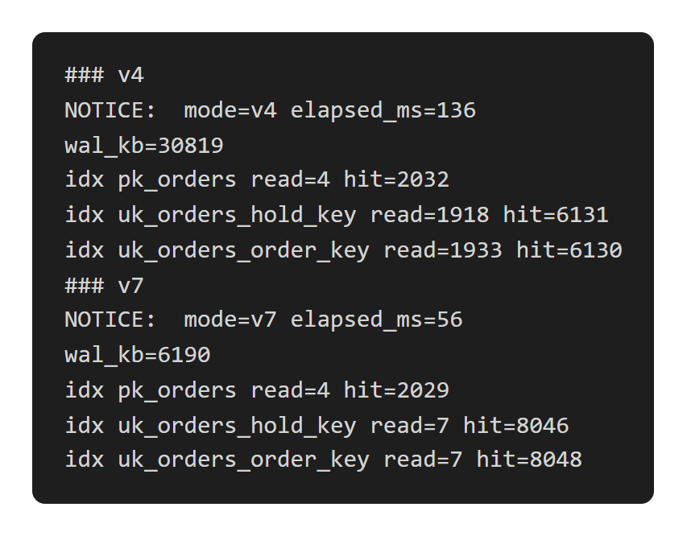
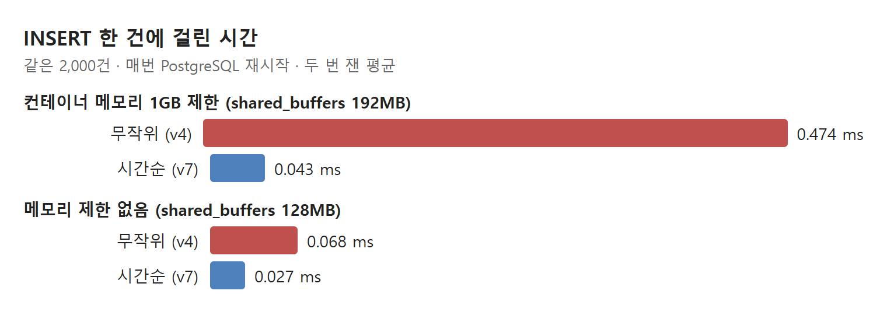

# 주문 INSERT가 느린 이유는 무작위 UUID 키였다: B-tree 리프 페이지와 메모리

- 주문 키는 무작위 UUID였다. 키마다 유일 인덱스가 있어 새 키는 인덱스 리프 페이지 3만 5천 개 중 아무 데나 떨어졌다.
- 인덱스가 메모리보다 커서 INSERT마다 인덱스 하나당 페이지 한 개를 메모리 밖에서 읽었다. 2,000건에 **1,933번** 읽었고, 시간순 UUID로는 **7번**이었다.
- 메모리를 1GB로 제한하자 한 건이 0.47ms 대 0.04ms로 열 배 넘게 벌어졌다. 처음 고치는 페이지는 통째로 WAL에 남아 쓰기 양도 늘었다.

## 무엇을 쟀나

운영 trace에서 주문 생성의 `INSERT INTO orders`가 3.3ms로, 같은 요청의 다른 문장(0.3~0.9ms)보다 5~10배 느렸다. orders에는 숫자 PK 말고도 `order_key`, `hold_key` 두 문자열 키에 유일 인덱스가 있다. 둘 다 `"ORDER-"` 같은 접두어에 무작위 UUID 32글자를 붙인 값이다.

로컬 PostgreSQL 18에 orders 571만 행을 두고, 같은 모양의 키로 2,000건을 한 건씩 넣은 뒤 롤백했다. 매번 PostgreSQL을 다시 띄워 공유 메모리를 비웠고, 무작위 키(UUIDv4)와 시간순 키(UUIDv7)를 번갈아 쟀다.

## 1. 인덱스는 위가 작고 아래가 크다

B-tree 인덱스는 8KB 페이지로 된 나무다. 맨 위 루트에서 중간 페이지를 거쳐 맨 아래 리프 페이지까지 내려가고, 실제 키는 리프에 정렬돼 있다. `pgstatindex`로 orders 인덱스를 열어 봤다.

키 인덱스는 루트를 포함해 4층이다. 중간 페이지는 260개 남짓(약 2MB)이고 리프는 3만 5천 개(약 275MB)다. 두 키 인덱스를 합하면 550MB인데, PostgreSQL이 페이지를 들고 있는 공유 메모리(`shared_buffers`)는 128MB다.

키가 38글자 문자열이라 8바이트 숫자인 PK보다 인덱스가 두 배 넘게 크다.

## 2. 무작위 키는 매번 다른 리프를 연다

INSERT 한 건은 인덱스마다 루트에서 리프까지 4페이지를 지난다. 중간 페이지는 모든 INSERT가 지나가므로 늘 메모리에 있다. 문제는 리프다. 무작위 키는 3만 5천 개 중 아무 리프에나 떨어지니, 그 페이지는 대부분 메모리에 없다.

무작위 키는 한 건에 적중 약 3번(루트·중간)과 읽기 약 1번(리프)이다. 시간순 키는 새 키가 한 구간에 모여 같은 리프 몇 개만 계속 쓰므로 4번이 모두 적중이다. 건드린 페이지 수는 같고, 어디서 가져오느냐만 다르다.

PK는 1씩 늘어 늘 맨 오른쪽 리프에 붙는다. PostgreSQL은 이 경우 마지막 리프를 기억해 두고 내려가는 과정을 건너뛰어 적중이 한 건에 약 1번이다.

| 2,000건 | 무작위 키 | 시간순 키 |
| --- | --- | --- |
| order_key 인덱스 읽기 | **1,933** | 7 |
| hold_key 인덱스 읽기 | 1,918 | 7 |
| PK 인덱스 읽기 | 4 | 4 |

배운 점: 인덱스가 메모리보다 커지는 순간, 키가 어디로 들어가는지가 성능을 정한다.

## 3. 같은 "읽기"도 어디서 오느냐에 따라 열 배 차이 난다

PostgreSQL이 "읽기"로 세는 것은 운영체제에 페이지를 달라고 한 횟수다. 운영체제 메모리(페이지 캐시)에 있으면 복사 한 번이고, 없으면 실제 디스크를 읽는다. 그래서 같은 읽기 횟수로도 환경에 따라 시간이 크게 달랐다.

메모리 제한이 없을 때는 인덱스 파일이 운영체제 메모리에 다 남아 차이가 2.5배였다. 1GB로 제한하자 디스크까지 가면서 11배가 됐다.

운영 DB는 접속 한도(79)로 미루어 메모리 1GB급이고, 디스크는 네트워크로 붙은 저장장치다. 그래서 3.3ms의 대부분이 이 리프 읽기라고 본다. 운영 DB의 읽기 통계로는 아직 확인하지 않았다(미확인).

## 4. 처음 고치는 페이지는 WAL에 통째로 남는다

PostgreSQL은 데이터를 고치기 전에 WAL(변경을 먼저 적는 로그)에 기록한다. 체크포인트 뒤 어떤 페이지를 처음 고치면, 쓰다 끊긴 페이지를 복구하려고 그 8KB를 통째로 WAL에 남긴다(`full_page_writes`).

무작위 키는 거의 매 INSERT가 처음 고치는 리프라 인덱스마다 8KB가 붙는다. 같은 2,000건의 WAL이 무작위 키는 여러 번 재서 28~39MB, 시간순 키는 1~17MB였다. 커밋은 WAL이 디스크에 내려가야 끝나므로 이 양도 시간이 된다.

## 5. 고치는 법

| 방법 | 효과 | 대가 |
| --- | --- | --- |
| 키를 UUIDv7로 만든다 | 리프 읽기 1,933 → 7(측정) | 키에 생성 시각(ms)이 드러난다 |
| 컬럼을 `uuid` 타입(16바이트)으로 | 인덱스가 작아진다 | 마이그레이션, 무작위성은 그대로 |
| DB 메모리를 키운다 | 인덱스가 다 들어가면 읽기가 사라진다 | 비용, 데이터가 늘면 다시 생긴다 |

UUIDv7은 앞 48비트가 밀리초 시각이라 새 키가 늘 한 구간에 모인다. 이미 저장된 행은 그대로 둬도 된다. 접두어와 32글자 모양을 유지하면 응답 형식도 바뀌지 않는다. 아직 적용하지는 않았다.

## 정리

- 무작위 키 인덱스는 INSERT마다 리프 페이지 하나를 새로 연다. 인덱스가 메모리보다 크면 그게 곧 디스크 읽기다.
- PostgreSQL의 "읽기"는 운영체제 캐시 적중을 포함한다. 로컬과 운영의 차이는 여기서 생긴다.
- 무작위 키는 WAL에도 페이지 전체 사본을 늘린다.

다음은 키를 UUIDv7로 바꾸고, 운영 DB에서 INSERT 시간과 인덱스 읽기를 다시 재는 일이다.
