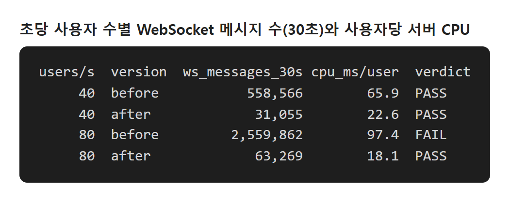
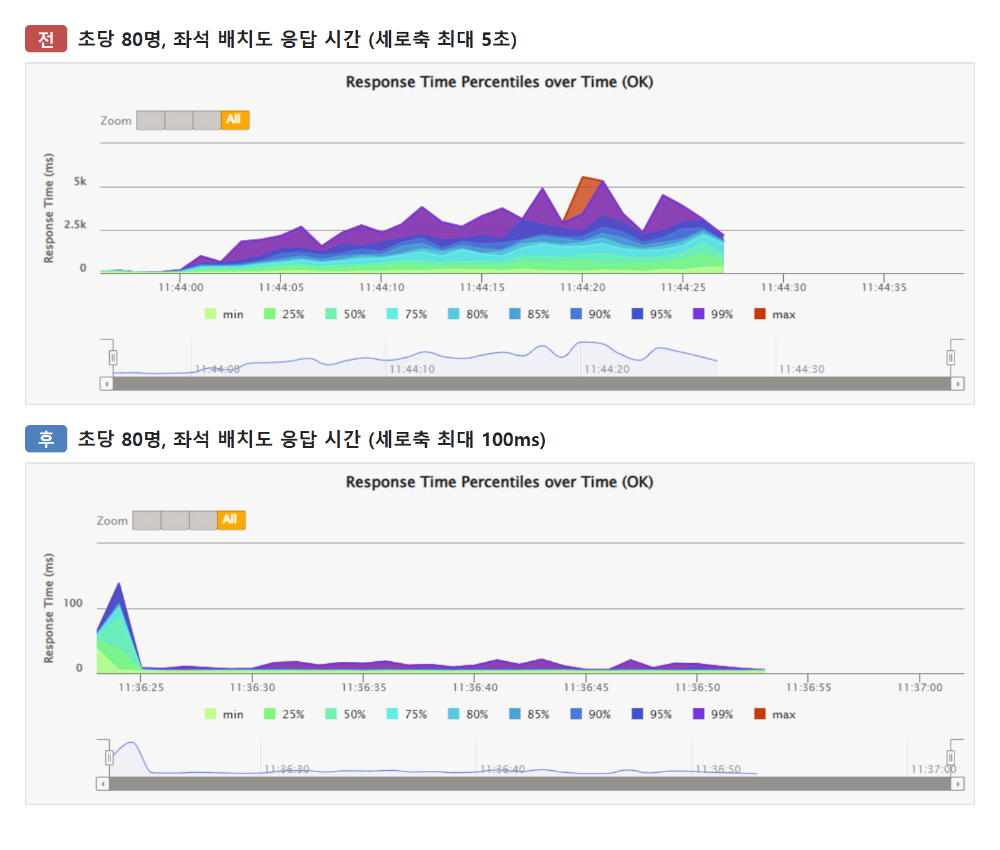
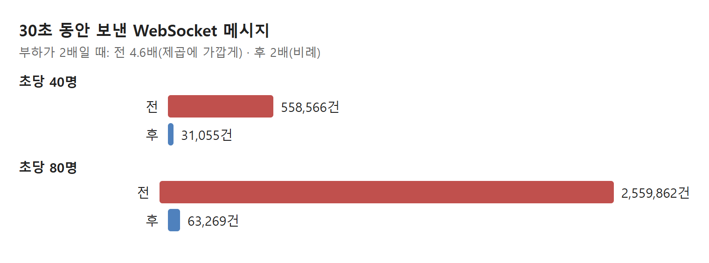

# 좌석 알림을 0.25초씩 묶었더니 WebSocket 메시지가 40분의 1이 됐다

- 좌석 하나가 바뀔 때마다 그 회차를 보는 모든 사람에게 메시지를 따로 보냈다. 메시지 수가 **사용자 수의 제곱**으로 늘어 서버 CPU를 먼저 다 썼다.
- 250ms 동안 들어온 알림을 회차마다 한 메시지로 묶고, 같은 좌석은 마지막 상태만 보내게 바꿨다.
- 초당 80명에서 30초 동안 보낸 메시지가 2,559,862건에서 **63,269건**으로 줄었고, 실패하던 측정이 통과했다. 운영 서버에서는 처음 실패하는 부하가 초당 25명에서 **90명**으로 올랐다.

## 무엇을 쟀나

공연 예매 백엔드(Spring Boot, PostgreSQL, Redis)에서 인기 공연이 열리는 순간을 흉내 냈다. 15,000석 회차에 사용자가 초당 N명씩 30초 동안 들어온다. 한 명은 좌석 알림 WebSocket에 연결하고, 좌석 배치도와 점유 좌석을 받고, 좌석을 골라 주문한다.

요청마다 응답 시간 기준(좌석 배치도는 p95 500ms, p99 1초)을 두고 하나라도 넘으면 실패로 봤다. 비교는 같은 PC(16코어)와 같은 데이터에서 서버 코드만 바꿔 했다.

## 1. CPU를 먹은 건 응답이 아니라 알림이었다

운영 서버(2 vCPU)에서는 초당 25명에서 CPU가 다 차서 실패했다. 응답을 하나씩 줄여 가던 중 숫자 하나가 눈에 띄었다. 30초 동안 좌석 알림은 1,567건이었는데 서버가 보낸 WebSocket 메시지는 **26만 7,742건**이었다.

좌석 알림은 "이 좌석이 방금 선택됐다"를 같은 회차를 보고 있는 사람들에게 알리는 메시지다. 서버는 알림 하나를 구독자 한 명마다 따로 만들어 보냈다. 메시지마다 STOMP 프레임 만들기, 압축, 소켓 쓰기가 한 번씩 든다.

로컬에서 같은 부하를 다시 재니 그대로 보였다.



## 2. 알림 하나가 구독자 수만큼 복제된다

사용자가 두 배가 되면 좌석을 고르는 사람도 두 배, 그 알림을 받는 사람도 두 배다. 그래서 메시지는 네 배가 된다. 실제로 초당 40명에서 80명으로 올리자 메시지가 558,566건에서 2,559,862건으로 4.6배 늘었다.

CPU가 이 일에 묶이자 다른 요청이 기다렸다. 가장 무거운 좌석 배치도 응답이 먼저 기준을 넘었다(p95 2,211ms). 배치도 코드는 그대로였으니, 느려진 원인은 CPU를 나눠 쓴 것으로 본다.

배운 점: 실패한 요청과 CPU를 쓴 일이 같지 않을 수 있다. 실패 항목보다 CPU가 어디로 가는지를 먼저 본다.

## 3. 250ms 동안 모아 회차마다 한 번 보낸다

알림을 받으면 바로 보내지 않고 회차·좌석별로 모아 둔다. 같은 좌석이 그 사이 여러 번 바뀌면 마지막 상태만 남긴다. 단일 스레드가 250ms마다 모은 것을 회차마다 메시지 하나로 보낸다.

```java
// 알림을 받으면: 회차 → 좌석 → 마지막 상태만 남긴다
pending.computeIfAbsent(event.performanceId(), id -> new LinkedHashMap<>())
       .put(event.seatId(), event);

// 250ms마다: 회차마다 메시지 하나
batch.forEach((performanceId, seats) ->
        messagingTemplate.convertAndSend(topic(performanceId), new SeatStatusBatch(performanceId, changes(seats))));
```

이제 메시지 수는 "구독자 수 × 초당 4"다. 사용자 수에 비례하므로 부하를 두 배로 올리면 메시지도 두 배다(31,055건 → 63,269건).

| 초당 80명, 30초 | 전 | 후 |
| --- | --- | --- |
| WebSocket 메시지 | 2,559,862건 | **63,269건** |
| 사용자당 서버 CPU | 97.4ms | 18.1ms |
| 좌석 배치도 p95 | 2,211ms | 14ms |
| 판정 | 실패 | 통과 |



배운 점: "실시간"이 "변경마다 즉시"일 필요는 없다. 화면이 그리는 것이 지금 상태라면 중간 상태는 버려도 된다.

## 4. 묶어도 되는 이유와 대가

이 방식을 실시간 메시징 쪽에서는 conflation이라고 부른다. 받는 쪽이 마지막 값만 쓰면 중간 값을 합쳐 보낸다. 묶어도 된다고 본 근거는 네 가지다.

- 좌석을 누가 샀는지는 알림이 아니라 Redis 스크립트가 정한다. 알림이 늦어도 중복 판매는 생기지 않는다(모든 측정에서 0건).
- 화면은 좌석마다 현재 상태 하나만 그린다.
- 내가 누른 좌석은 화면이 먼저 바꿔 그리므로 알림을 기다리지 않는다.
- 알림을 나르는 Redis pub/sub은 원래 최대 한 번 전달이었다. 정확한 상태는 화면을 새로 불러올 때 맞춰진다.

대가도 있다. 남의 선택이 최대 250ms 늦게 보이므로, 이미 잡힌 좌석을 누르는 경우가 조금 늘 수 있다. 이 증가는 아직 재지 않았다. 메시지 모양이 단건에서 `changes` 배열로 바뀌어 화면 쪽 코드도 바꿔야 한다.

| 비교 | 묶기 전 | 묶은 뒤 |
| --- | --- | --- |
| 메시지 수 | 알림 수 × 구독자 수 | 구독자 수 × 초당 4 |
| 부하 2배일 때 | 4.6배 | 2배 |
| 알림 지연 | 즉시 | 최대 250ms |



## 5. 운영 서버에서 다시 쟀다

같은 변경을 운영 서버(2 vCPU, 메모리 4GB)에 배포하고 같은 시나리오로 부하를 5명씩·10명씩 올렸다. 바꾸기 전에는 초당 25명에서 실패했다.

| 운영 서버 | 전 | 후 |
| --- | --- | --- |
| 처음 실패한 부하 | 초당 25명 | **초당 90명** |
| 사용자당 서버 CPU | 55~66ms | 16~17ms |
| 통과한 최대 부하 | 초당 20명 | 초당 80명 |

초당 90명에서는 사용자당 CPU가 그대로인데 서버 CPU 두 개가 꽉 찼다. 이제 막는 것은 알림이 아니라 요청을 처리하는 일 자체의 양이다.

## 정리

- 메시지 수가 사용자 수의 제곱으로 느는 구조는 CPU를 가장 먼저 다 쓴다. 보낸 메시지 수를 지표로 꼭 본다.
- 받는 쪽이 지금 상태만 쓰면, 시간 간격으로 묶고 같은 대상은 마지막 값만 보내도 된다.
- 묶을 수 있는지는 정확성을 무엇이 지키는지로 정한다. 여기서는 알림이 아니라 Redis가 지켰다.

다음은 사용자당 16ms를 어디에 쓰는지 프로파일러로 쪼개는 일과, 250ms 지연으로 "이미 선택된 좌석" 응답이 얼마나 느는지 확인하는 일이다.
