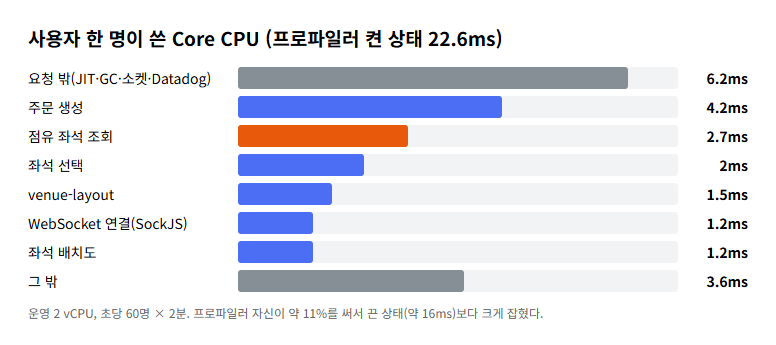
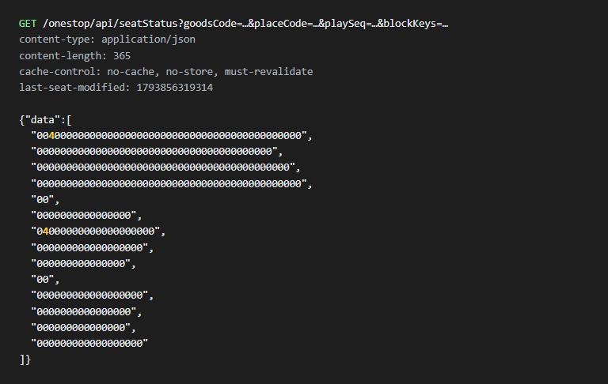
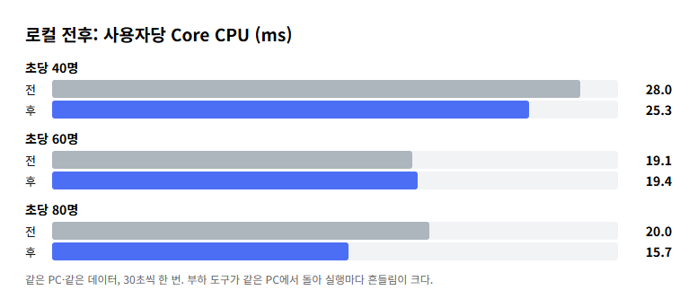

# 사용자 한 명이 쓰는 CPU 16ms를 쪼개 봤다: 일보다 포장이 비쌌다

- 인기 공연 오픈 부하에서 서버가 초당 90명에서 처음 무너졌다. 막은 것은 2코어 서버의 CPU였고, 사용자 한 명이 Core CPU를 약 16ms 썼다.
- 운영 프로파일로 16ms를 나눠 보니, DB 저장 같은 실제 일보다 같은 응답을 매번 다시 만들고 매번 압축하는 비용이 더 컸다.
- 좌석 상태를 좌석당 1비트로 줄이고 WebSocket 압축을 껐다. 다만 로컬 전후 측정은 흔들렸고, 주문 응답이 오히려 3ms 늘어 원인을 찾는 중이다.

## 무엇을 쟀나

티켓 예매 서비스의 백엔드(Spring Boot, PostgreSQL, Redis)를 2 vCPU·4GB 서버 한 대에 올리고, 부하 도구 Gatling으로 "인기 공연 오픈" 상황을 재현했다. 사용자 한 명은 좌석 배치도를 받고, 점유 좌석을 확인하고, 좌석을 누르고, 주문한다. 초당 들어오는 사용자 수를 올려 가며 서버 쪽 응답 시간이 기준을 넘는 첫 지점을 찾는다.

## 16ms는 어디에 쓰였나

초당 90명에서 모든 요청이 함께 느려졌다. 프로세스 CPU가 꽉 찼으니 사용자 한 명이 쓰는 CPU를 줄여야 했다. 운영에 Datadog 프로파일러를 잠깐 켜고 초당 60명으로 2분을 돌린 뒤, CPU 시간을 엔드포인트별로 나눴다.



눈에 띈 것은 둘이다. 첫째, **점유 좌석 조회가 요청당 2.3ms**인데 그중 DB·Redis를 읽는 시간은 0.1ms였다. 나머지는 같은 목록을 요청마다 JSON으로 바꾸고 gzip으로 압축하는 데 썼다. 둘째, WebSocket 알림을 보낼 때 **메시지 압축이 전체 CPU의 5.7%**를 썼다.

배운 점: 병목이 CPU면 "무슨 일을 하나"보다 "같은 일을 몇 번 반복하나"를 먼저 본다.

## 좌석 상태를 좌석당 1비트로

점유 좌석 응답은 팔렸거나 누가 잡은 좌석 ID를 나열한다. 매진에 가까워질수록 길어져 15,000석 공연이면 약 100KB다. 다른 예매 사이트는 어떻게 하는지 실제 예매 화면의 요청을 열어 봤다.



그 사이트는 좌석 상태를 **좌석당 1비트**로 보내고 약 4초마다 다시 받았다. 1,674석 공연 전체가 약 450바이트라 압축하지 않았다. 좌석 위치처럼 바뀌지 않는 정보는 처음에 한 번만 크게 받는다.

우리도 같은 생각으로 새 API를 만들었다. 좌석을 ID 순서로 세우고, 고를 수 있으면 1을 쓴 뒤 base64로 보낸다.

```json
{"seatCount": 8, "available": "tg==", "summary": {}}
```

| 15,000석, 매진 직전 | 전 | 후 |
| --- | --- | --- |
| 응답 크기 | 약 100KB(좌석 ID 목록) | 약 2.5KB(비트) |
| 요청마다 하는 일 | JSON 변환 + gzip | 작은 JSON 변환 |

바뀐 좌석은 지금처럼 WebSocket 알림으로 받는다. 알림에는 좌석 ID가 있어 비트 순서와 상관없다. 처음 받는 상태의 모양만 바꾼 것이다.

배운 점: 응답을 작게 만들면 압축과 캐시가 함께 필요 없어진다.

## WebSocket 압축은 왜 기본으로 켜져 있나

WebSocket 메시지 압축(permessage-deflate)은 브라우저가 늘 요청하고 서버가 기본으로 받아들인다. 연결마다 압축 상태를 따로 들고 있어서, 같은 알림도 **구독자 500명이면 500번 압축한다.** 메시지를 한두 명에게 보내는 채팅에는 맞는 기본값이지만, 같은 알림을 수백 명에게 뿌리는 좌석 화면에는 맞지 않는다.

처음에는 Spring의 핸드셰이크 처리기에서 받아들일 확장 목록을 비우면 꺼질 줄 알았다. 실제 Tomcat에서 시험해 보니 응답에 `permessage-deflate`가 그대로 남았다. Tomcat은 넘겨받은 목록이 비어 있으면 자기 기본 확장으로 요청 헤더와 다시 협상했다. 그래서 Tomcat에 넘기기 전에 요청의 압축 헤더 자체를 감췄다.

```java
// Tomcat이 기본 확장으로 다시 협상하지 않도록 요청의 확장 헤더를 감춘다
HttpServletRequest hidden = new HttpServletRequestWrapper(request) {
    @Override public String getHeader(String name) {
        return "Sec-WebSocket-Extensions".equalsIgnoreCase(name) ? null : super.getHeader(name);
    }
};
```

압축은 연결할 때 합의하는 선택 기능이라, 서버가 거절해도 기존 프런트엔드는 코드 수정 없이 압축 없이 동작한다. 대가는 알림 전송량이 5~10배가 되는 것이다. 지금 서버 송신은 초당 약 2MB라 여유가 있지만, 알림 전송량은 사용자 수의 제곱에 가깝게 늘어 측정 때 함께 기록하기로 했다.

배운 점: "설정을 비우면 꺼진다"는 실제 서버로 확인하기 전까지 가설이다.

## 로컬 전후 측정: 줄었지만 깔끔하지 않았다

이 둘에 주문 저장 쿼리 줄이기, 시간순 UUID 키, 업무 예외의 스택 생략, 보안 계측 끄기를 더해 같은 PC·같은 데이터에서 Core만 바꿔 쟀다.



| 부하 | 사용자당 CPU 전 → 후 | 주문 응답 평균 전 → 후 |
| --- | --- | --- |
| 초당 40명 | 28.0 → 25.3ms | 7.6 → 10.6ms |
| 초당 60명 | 19.1 → 19.4ms | 6.4 → 12.2ms |
| 초당 80명 | 20.0 → **15.7ms** | 7.2 → 10.1ms |

CPU는 대체로 줄었지만 실행마다 흔들려, 설계에서 추정한 약 23% 감소를 확정하지 못했다. 부하 도구가 같은 PC에서 돌았고 30초 실행을 한 번씩만 했다. 더 신경 쓰이는 것은 주문 응답이다. DB 저장 시간은 1.62ms에서 1.09ms로 줄었는데, 주문 요청 전체는 약 3ms 늘었다. 원인은 아직 모른다(미확인).

배운 점: 여러 변경을 한 번에 재면 좋아진 것과 나빠진 것이 섞여 어느 쪽인지 알 수 없다.

## 정리

- CPU가 병목이면 일 자체보다 반복되는 포장(변환, 압축, 계측)을 먼저 본다.
- 실제 서비스가 어떻게 하는지 요청을 열어 보면 설계 근거가 단단해진다.
- 기본값은 흔한 경우에 맞춰져 있다. 우리 트래픽 모양이 다르면 기본값부터 의심한다.

다음 할 일은 주문 trace를 전후로 비교해 늘어난 3ms를 찾는 것, 그리고 운영에서 변경을 하나씩 나눠 재는 것이다.
