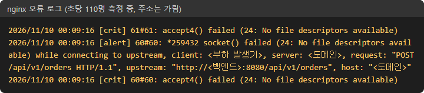
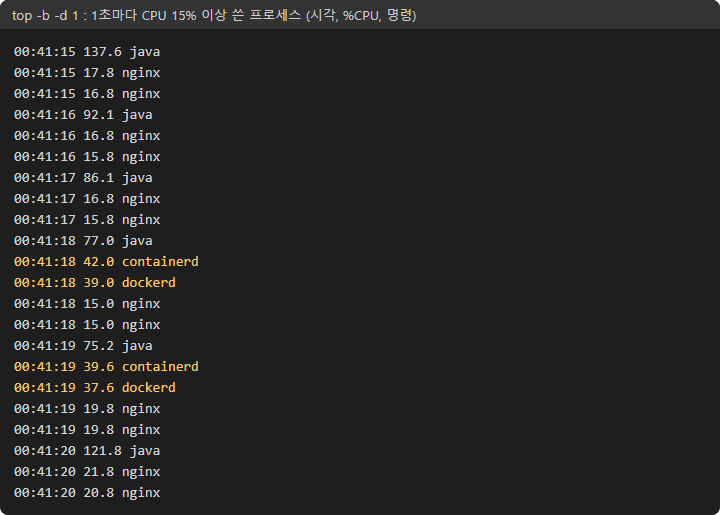
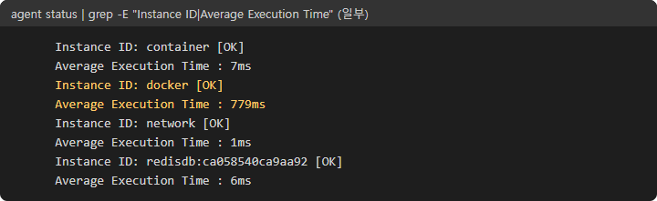
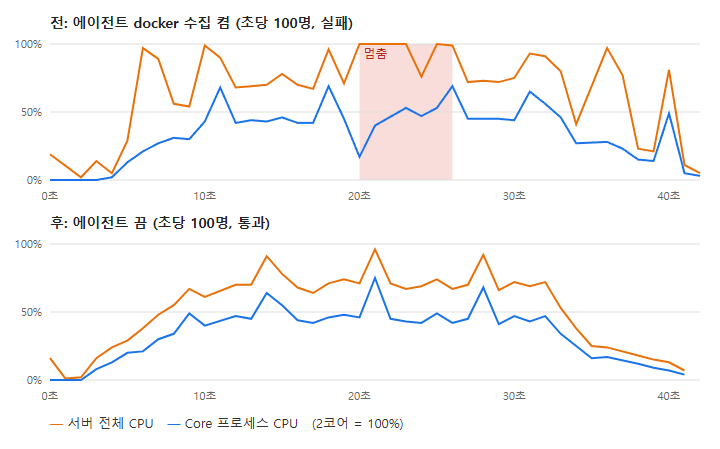

# 초당 90명에서 130명으로: 마지막 병목 둘은 코드 밖에 있었다

- 코드를 고쳐 사용자 한 명이 쓰는 CPU를 16ms에서 11ms로 줄였는데, 서버는 초당 110명에서 여전히 무너졌다.
- 원인은 둘 다 애플리케이션 밖에 있었다. 앞단 nginx의 파일 수 상한, 그리고 감시 에이전트가 15초마다 일으킨 CPU 폭주다.
- 설정 몇 줄로 첫 실패 지점이 초당 90명에서 **130명**으로 올랐다. 3주 동안 "원인 미확인"으로 남아 있던 15초 멈춤도 이번에 풀렸다.

## 무엇을 쟀나

티켓 예매 서비스(Spring Boot, PostgreSQL, Redis)를 2 vCPU 서버 한 대에 올리고, 앞에 nginx를 두었다. Gatling으로 "인기 공연 오픈"을 재현했다. 사용자는 배치도를 받고, 좌석 상태를 보고, 좌석을 고르고, 주문한다. 초당 들어오는 사용자 수를 10명씩 올리며 30초씩 재고, 요청별 응답 시간 기준을 넘거나 응답 없는 요청이 0.1%를 넘으면 실패로 본다.

## 1. 응답 없음이 1초 안에 몰렸다

초당 110명에서 요청 2~3%가 응답 없이 끊겼다. 처음엔 데이터베이스 연결이 모자란 줄 알았다. 그런데 끊긴 시각을 초 단위로 세어 보니 30초 중 **딱 두 순간**에 몰려 있었다. 자원이 서서히 모자라면 실패도 서서히 늘어야 한다. 한순간에 수십 개가 끊긴 것은 연결 여럿이 동시에 닫혔다는 뜻이다.

| 끊긴 시각 | 끊긴 사용자 |
| --- | --- |
| 23:54:49 | 64 |
| 23:55:07 | 44 |
| 나머지 28초 | 0 |

첫 가설은 틀렸다. 부하 도구는 가상 사용자들이 연결 몇십 개를 나눠 쓰므로, 그 연결들이 nginx의 "연결 하나당 요청 1,000개" 상한에 동시에 닿는다고 봤다. 상한을 10,000으로 올리자 끊김은 오히려 **8.4%**로 늘었다. 그제야 nginx 오류 로그를 다른 말로 찾았다.



`No file descriptors available`는 프로세스가 열 수 있는 파일·연결 수가 바닥났다는 뜻이다. nginx 작업 프로세스의 상한은 기본 1,024였다. 동시 사용자 약 970명이 WebSocket을 하나씩 열고, nginx는 WebSocket 하나에 사용자 쪽과 백엔드 쪽 두 칸을 쓴다. 두 프로세스가 나눠도 각자 1,024에 붙는다. 처음에 `not enough`라는 다른 문구로만 찾아서 놓쳤다.

```nginx
worker_rlimit_nofile 65535;
events { worker_connections 8192; }
```

| 초당 110명 | 응답 없음 |
| --- | --- |
| 기본 설정 | 3.3% |
| 요청 상한 1,000 → 10,000(틀린 가설) | 8.4% |
| 파일 수 상한 1,024 → 65,535 | **0%** |

배운 점: 실패를 시각별로 세면 "서서히 모자람"과 "한꺼번에 끊김"이 갈린다.

## 2. 앱은 놀고 서버는 꽉 찼다

끊김은 사라졌지만 응답이 느려 여전히 실패했다. Core 프로세스 CPU는 2코어의 40~67%인데, 서버 전체 CPU는 측정 시간 절반 동안 100%였다. 컨테이너별로 나눠 보니 Core가 0.95코어, **nginx가 0.48코어**를 썼다.

nginx 설정을 다시 보니 `/api/` 요청마다 `Connection: upgrade` 헤더를 붙이고 있었다. WebSocket용 설정을 일반 요청에도 복사해 둔 것이다. 이 헤더가 붙으면 nginx는 백엔드 연결을 재사용하지 못하고 요청마다 새로 연다.

```nginx
upstream backend { server app:8080; keepalive 64; keepalive_timeout 15s; }
location /api/ { proxy_http_version 1.1; proxy_set_header Connection ""; }
```

`keepalive_timeout`은 백엔드(Tomcat)가 쉬는 연결을 먼저 닫기 전에 nginx가 먼저 정리하게 하려고 짧게 두었다. 같은 조건의 비교는 아니지만, nginx CPU는 초당 100명에서 약 0.3코어로 내려갔다.

배운 점: 앱 프로세스의 CPU만 보면 여유가 있어 보인다. 서버 전체 CPU와 나란히 본다.

## 3. 3주 동안 못 잡은 15초 멈춤

이제 초당 100명이 어떤 날은 통과하고 어떤 날은 실패했다. 실패한 날의 그래프에는 늘 같은 모양이 있었다. 약 15초마다 1~5초 동안 서버 CPU가 100%가 되는데, 그 순간 Core의 CPU는 오히려 내려갔다. 3주 전부터 측정 일지에 "15초 주기 멈춤, Core 밖 프로세스가 유력(미확인)"으로 적혀 있던 현상이다.

모니터링 도구는 프로세스별 CPU를 15초 평균으로만 남겨서 1~2초짜리 튐이 묻혔다. 그래서 서버에서 `top`을 1초 간격으로 3분 기록하는 동안 부하를 한 번 더 보냈다.



`dockerd`와 `containerd`가 15초마다 함께 약 40~70%씩 튀었다(100% = 1코어). 부하가 없을 때도 같았다. 15초는 감시 에이전트(Datadog Agent)의 기본 수집 간격이다. 에이전트의 수집 작업별 평균 시간을 보니 하나가 두드러졌다.



`docker` 수집은 15초마다 Docker 데몬에 컨테이너·이미지 정보를 묻는다. 그 한 번이 779ms 걸리고, 대답하는 동안 Docker 데몬이 1코어 가까이 쓴다. 같은 컨테이너 CPU·메모리는 7ms짜리 `container` 수집이 따로 모으고 있었다. 그래서 `docker` 수집만 껐다. 이 에이전트는 기본 수집을 끄는 환경변수가 없어서, 그 설정 폴더를 빈 폴더로 덮었다.



| 초당 100명 | 에이전트 켬 | 에이전트 끔 |
| --- | --- | --- |
| 서버 CPU 100%였던 초 | 5 / 31 | 0 / 28 |
| 바쁜 요청 스레드 최대 | 107 | 42 |
| 좌석 상태 p99(1분 구간) | 1,077ms | **75ms** |
| 판정 | 실패 | 통과 |

배운 점: 짧고 주기적인 멈춤은 평균 지표에 묻힌다. 1초 단위로 직접 기록해야 보인다.

## 정리

에이전트를 켠 원래 조건으로 다시 재니 초당 110·120명은 통과, **130명에서 처음 실패**했다. 130명에서도 응답 없는 요청은 0이고, 이제는 서버 CPU 2코어를 Core와 nginx가 실제로 다 쓰는 지점이다.

| 단계 | 첫 실패 |
| --- | --- |
| 시작 | 초당 90명 |
| 코드: 사용자당 CPU 16 → 11ms | 초당 110명 |
| nginx 파일 수 상한·연결 재사용, 에이전트 docker 수집 끄기 | **초당 130명** |

- 실패를 시각별로 세면 원인의 모양이 보인다.
- 앱 CPU가 아니라 서버 전체 CPU를 본다. 2코어 서버에서는 곁에 도는 프로그램 몫이 크다.
- 평균이 숨기는 짧은 멈춤은 1초 단위 기록으로 잡는다.

다음은 에이전트가 15초마다 Core 지표를 전부 긁어 가는 설정이다. 그 순간 Core CPU도 50~70%로 튄다.
