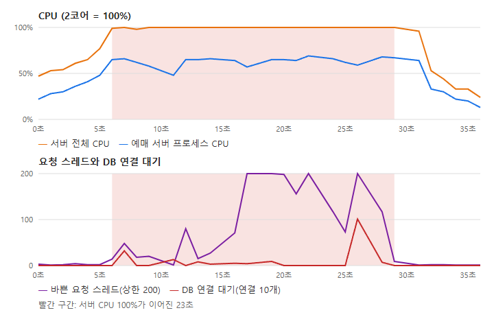
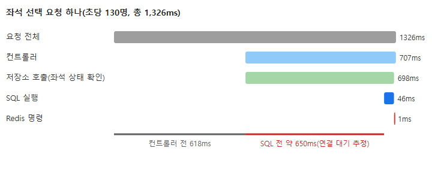
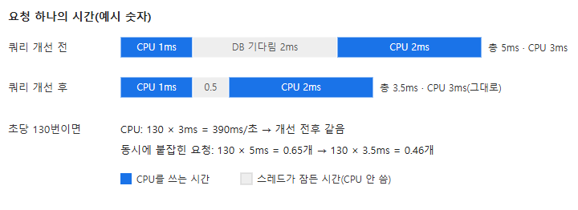

# CPU 100%를 잡으려다 알게 된 것: 쿼리를 빠르게 해도 CPU는 그대로였다

- 지금 내 문제는 2코어 서버의 CPU 100%다. 초당 130명에서 서버 CPU가 23초 내내 100%였고, 응답 시간이 기준을 넘었다.
- 처음엔 DB 쿼리를 빠르게 하면 CPU도 줄 거라 생각했다. 조사해 보니 DB를 기다리는 스레드는 CPU를 쓰지 않았다. 쿼리 속도가 줄여 주는 것은 CPU가 아니라 연결과 스레드를 붙잡는 시간이었다.
- 그래서 해결책을 "요청 하나가 쓰는 CPU를 줄이는 것"과 "요청 수를 줄이는 것"으로 다시 정리하고, 지금 CPU가 어디에 쓰이는지부터 다시 재기로 했다.

## 무엇을 쟀나

티켓 예매 서비스의 백엔드(Spring Boot, PostgreSQL, Redis)를 2 vCPU 서버 한 대에 올리고, 앞에 nginx를 두었다. DB는 별도 서버(AWS RDS)다. Gatling으로 "인기 공연 오픈"을 재현해 초당 들어오는 사용자를 10명씩 올리며 30초씩 쟀다. 요청별 응답 시간이 기준을 넘으면 실패로 본다.

결과는 초당 120명 통과, **초당 130명 실패**였다. 끊긴 요청은 0이었고, 좌석 상태 조회 p95가 781ms로 기준 500ms를 넘었다.

## 1. 130명에서 무슨 일이 있었나

1초마다 기록한 서버 지표를 보니 순서가 보였다. 먼저 서버 전체 CPU가 100%에 붙었다. 그다음 DB 연결 풀(HikariCP, 연결 10개)에 대기가 쌓였고, 마지막으로 요청 처리 스레드(Tomcat, 200개)가 전부 찼다.



| | 초당 120명(통과) | 초당 130명(실패) |
| --- | --- | --- |
| 서버 CPU 100% | 띄엄띄엄 몇 초 | **23초 연속** |
| DB 연결 한 번 쥐는 평균 시간 | 6.9ms | 11.3ms |
| DB 연결 대기 최대 | 2 | 101 |
| 바쁜 요청 스레드 최대 | 30 | 200(상한) |

부하는 8% 늘었는데 DB 연결을 기다린 시간의 합은 13.7초에서 302.7초로 22배가 됐다. 처음에는 이 숫자만 보고 "DB가 느려져서 막혔다"고 생각했다.

배운 점: 여러 지표가 동시에 나빠지면, 1초 단위로 어느 것이 먼저 나빠졌는지부터 본다.

## 2. 느린 요청 하나를 열어 보니

DB가 범인인지 보려고, 이 구간의 느린 요청 하나를 추적 도구(Datadog APM)로 열었다. 좌석 선택 요청 하나가 1,326ms 걸렸는데, 그중 SQL 실행은 **46ms**였다.



나머지는 기다린 시간이었다. 컨트롤러에 닿기 전까지 618ms, 저장소 호출을 시작하고 SQL을 보내기까지 약 650ms다. 앞의 것은 CPU 차례를 기다린 시간으로 보고, 뒤의 것은 DB 연결을 빌리려고 기다린 시간으로 본다(둘 다 추정). 쿼리를 아무리 빠르게 해도 1,326ms 중 46ms 안에서만 줄어든다.

배운 점: 응답이 느릴 때 "어디서 일했나"와 "어디서 기다렸나"를 나눠 본다.

## 3. 쿼리를 빠르게 해도 CPU가 안 주는 이유

여기서 내 처음 생각이 틀렸다는 걸 알았다. 스레드가 DB 응답을 기다리는 동안 운영체제는 그 스레드를 재운다. 잠든 스레드는 CPU를 쓰지 않고, 그동안 CPU는 다른 요청의 일을 한다.



그래서 CPU 사용량은 이렇게 정해진다.

```
CPU 사용량 = 초당 요청 수 × 요청 하나가 쓰는 CPU
```

쿼리 실행 시간은 이 식 어디에도 없다. 쿼리를 빠르게 하면 요청이 빨리 끝나 **DB 연결과 스레드가 빨리 풀린다**. 130명에서 연결 대기 101과 스레드 200이 생긴 데에는 이 효과가 있다. 하지만 그 대기가 생긴 시작점은 CPU였다. 연결을 쥔 채 CPU 차례를 기다리느라 쥐는 시간이 6.9ms에서 11.3ms로 늘었기 때문이다.

반대로 CPU를 줄이는 DB 쪽 방법도 있다. 쿼리 **횟수**를 줄이는 것이다. DB 왕복 하나마다 SQL을 만들고, 결과를 객체로 바꾸고, 추적 기록을 남기는 데 예매 서버가 CPU를 쓴다. 가져오는 행과 열을 줄이는 것도 같은 이유로 효과가 있다.

배운 점: "빠르게"와 "적게"는 다르다. CPU를 줄이는 건 일의 양이고, 시간을 줄이는 건 자리를 비우는 일이다.

## 4. 그래서 지금 고민하는 해결책

CPU를 줄이려면 식의 두 항, 요청 수와 요청 하나의 CPU를 줄여야 한다. 이 서버에서는 예매 서버만 CPU를 쓰는 게 아니라는 점도 알게 됐다. 초당 130명에서 예매 서버가 2코어 중 약 1.2~1.4코어를 썼고, 같은 서버의 nginx가 약 0.35코어를 썼다.

| 후보 | 무엇을 줄이나 | 근거 |
| --- | --- | --- |
| 거의 안 바뀌는 GET 응답(좌석 배치도 등)을 nginx가 저장해 대신 응답 | 요청 수 | 사용자 한 명의 요청 약 5.6번 중 2번 |
| 요청마다 붙는 고정 비용(보안 필터, 추적, 지표, 모듈 계측) | 요청 하나의 CPU | 예전 프로파일에서 전체 CPU의 약 27% |
| 주문 한 번의 DB 왕복 4번 줄이기 | 요청 하나의 CPU | 왕복 하나에 0.3~0.5ms(예전 측정) |
| HTTPS 처리를 서버 밖(로드 밸런서)으로 | 같은 서버의 다른 프로그램 | 사용자마다 새 WebSocket 연결의 TLS 핸드셰이크 |

다만 마지막 프로파일은 최근 코드 변경 전에 잰 것이라, 지금 요청 하나의 CPU(약 10ms)가 어디에 쓰이는지는 다시 재야 한다. 어림으로 순서를 정하지 않고, 프로파일러를 켜고 2분을 다시 재서 숫자로 순서를 정하려고 한다.

## 정리

- CPU 사용량은 "초당 요청 수 × 요청 하나의 CPU"다. 기다리는 시간은 들어가지 않는다.
- 쿼리 속도 개선은 연결·스레드가 모자랄 때 효과가 있고, CPU에는 쿼리 횟수와 결과 크기가 효과가 있다.
- 지표가 함께 나빠질 때는 먼저 나빠진 것과 따라 나빠진 것을 나눈다.

다음 할 일은 새 프로파일로 요청 하나의 CPU 내역을 다시 나누고, 가장 큰 덩어리부터 줄이는 것이다.
